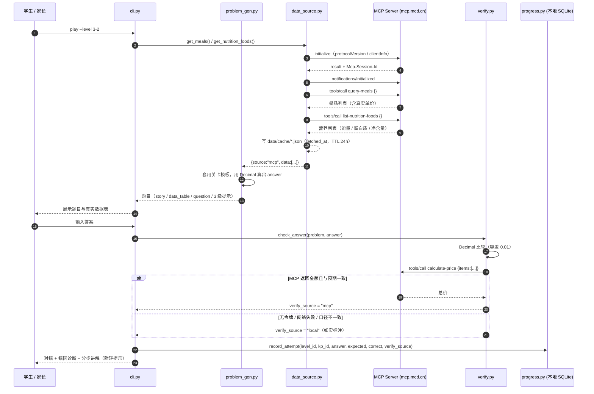

# MCP 集成说明（评委请看这一份）

本项目的立论只有一句：**题目里的数字都是真的，答案由麦当劳 MCP 真实计算校验。**
下面把「用了什么、怎么调、为什么非它不可、断了怎么办、安全怎么保证」全部写实。

- 端点：`https://mcp.mcd.cn`
- 传输：JSON-RPC 2.0 over Streamable HTTP
- 请求头：`Authorization: Bearer <MCD_MCP_TOKEN>`、`Accept: application/json, text/event-stream`
- 调用顺序：`initialize` → `notifications/initialized` → `tools/call`
- 实现：`scripts/mcp_client.py`，**纯 Python 标准库**（`urllib.request` / `json`），无第三方 SDK

## 一、用了哪些 Server / Tool

| 工具名 | 用途 | 对应题型 | 为什么非它不可 |
| --- | --- | --- | --- |
| `query-meals` | 可售餐品与单价 | 关卡 3 乘法、关卡 8 平均数、关卡 9 折扣 | 单价是题目的已知条件，必须是当日真实售价，不能由大模型虚构 |
| `list-nutrition-foods` | 能量 kcal、蛋白质 g、净含量 g | 关卡 1 加法、关卡 2 连减、关卡 5 单位换算、关卡 7 百分数 | 营养表数值自洽（能量与三大营养素匹配），编造的数字经不起追问 |
| `query-meal-detail` | 单个餐品详情 | 取数校验 / 课堂单题追问 | 需要按餐品名精确定位一条记录，避免同名项混淆 |
| `calculate-price` | 官方价格计算 | **全部 9 关的答案复核** | 这是「答案可验证」的技术支点：算术结果能被官方计价接口对上，才算真 |
| `available-coupons` | 券的门槛与面额 | 关卡 9 折扣与方案比较 | 门槛（满 X 元）与面额是真实规则，决定「哪张券可用」 |
| `campaign-calendar` | 活动起止时间 | 关卡 6 时间与行程 | 「含首尾算天数」必须依赖真实的起止日期，编不出来 |
| `mall-points-products` | 积分商品所需积分 | 关卡 4 除法与余数 | 积分价格是整数且非整倍数，天然适合「商 + 余数」 |
| `now-time-info` | 当前时间 | 时间类题的基准日期 | 让「还剩多少天」这类问法有真实参照 |

> 另外 7 个**写操作**工具（创建订单、取消订单、新增收货地址、商城下单、拼单、抽奖、
> 自动绑定券）在本项目中被显式列入黑名单，代码层面不可达，见第五节。

## 二、完整调用链



## 三、业务价值：为什么离了 MCP 就做不了

**1）数据真实性 —— 题目里的数字可被外部核验。**
教材题与模型生成题的共同问题是「数字是编的」。本项目所有题干数值都能在当天菜单/营养表里找到出处：
`9.00 元` 是 `query-meals` 返回的单价，`530 千卡` 是 `list-nutrition-foods` 返回的能量。
孩子做完题可以自己去点开餐品页面对照——这让「做完题」变成一个可信的闭环。

**2）答案可验证性 —— 判对错不靠模型自信。**
普通 AI 出题的致命伤是「答案对不对没人知道」。本项目把判定拆成两层：

- 第一层：出题时用 `Decimal` 精确计算 `answer`（避免浮点误差，`0.1 + 0.2` 这类坑不存在）；
- 第二层：作答后再调 `calculate-price` 复核，只有接口真的返回金额且与预期一致，
  `verify_source` 才标 `"mcp"`；否则如实标 `"local"`。

于是「这题答案是真的」这句话有技术含义，而不是宣传语。

**3）场景不可穷举 —— 数据每天变，题目每天新。**
价格、券门槛、活动日期都会变。硬编码题库三个月就过期；接 MCP 则天然保持新鲜，
且能让家长看到「今天菜单上的价格」这类真实情境，而不是「小明有 5 个苹果」。

## 四、降级策略（三级）

| 级别 | 触发条件 | 返回标注 | 用户可见提示 |
| --- | --- | --- | --- |
| `mcp` | 有令牌 + 网络通 + 工具返回非空 | `source: "mcp"` | 「实时数据（麦当劳 MCP）」 |
| `cache` | MCP 失败，但 `data/cache/<name>.json` 存在且 `fetched_at` 在 24h 内 | `source: "cache"` | 「本地缓存（最近一次 MCP 结果）」 |
| `sample` | 前两级都不可用 | `source: "sample"` | 「示例数据（仅用于离线演示）」 |

- 缓存文件带 `fetched_at`，超过 TTL 自动失效并重新拉取；写入采用「临时文件 + 原子替换」。
- `python scripts/data_source.py --fetch` 一次性预热全部缓存；`--status` 打印每个数据源的当前级别。
- 演示页顶部有数据来源徽标，示例数据固定显示「示例数据」角标，不伪装成实时。
- 缓存与示例数据只是**演示保底**，不会改变「有令牌时优先真实调用」的顺序。

## 五、安全设计

**1）只读白名单（代码层强制）**

```python
READONLY_WHITELIST = frozenset({
    "list-nutrition-foods", "query-meals", "query-meal-detail", "calculate-price",
    "available-coupons", "campaign-calendar", "mall-points-products", "now-time-info",
})

def call_tool(self, name, arguments=None):
    if name in FORBIDDEN_WRITE_TOOLS or name not in READONLY_WHITELIST:
        raise PermissionError(...)
```

白名单外的任何工具名（包括未来新增的）都调不动，属于「默认拒绝」而非「默认允许」。

**2）令牌不落库、不落日志**

- 只从环境变量 `MCD_MCP_TOKEN` 读取，缺失时抛 `McpConfigError` 并降级，不打印令牌本身；
- `mcp-config.example.json` 只有 `Bearer ${MCD_MCP_TOKEN}` 占位符；
- 仓库 `.gitignore` 屏蔽 `.env`、`*.token`、`data/cache/`、`runtime/`。

**3）不采集儿童信息**

进度库 `runtime/progress.db` 只有四类字段：关卡号、知识点号、答案文本、是否正确与时间戳。
没有姓名、手机号、邮箱、学校、地区、生日，也不做任何上传。

**4）网络健壮性**

- 单次请求 20 秒超时；HTTP 401/403 归类为配置错误并直接降级；
- 同一进程内复用连接（复用 `Mcp-Session-Id`），一次出题最多 6 次外部请求；
- SSE 与纯 JSON 两种响应形态都解析（`data:` 多行拼接、忽略 `event:`/`id:`/`retry:`）。

**5）输出可信度分级**

任何一处展示都会同时给出「数据级别」与「校验来源」，不做「假装实时」的处理：
`doctor`、`play` 开场、题目卡片、周报、演示页徽标均可核对。

---

非麦当劳官方产品，输出仅供参考，餐品信息与价格以麦当劳官方渠道实时结果为准。
