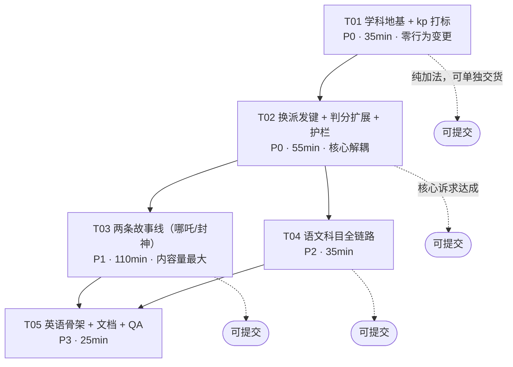

# 实施设计 · 故事线与题库解耦 + 学科扩展

> 输入：`docs/模块化设计方案-故事线与题库解耦.md`（设计提案）
> 本文职责：把它落到**可执行的粒度** —— 文件清单、依赖顺序、每步验收命令、时间盒砍单线。
> 基线：HEAD `d9cbd13`，工作区干净（仅本文件与前一份提案未跟踪）。
> 截止：23:59。**宁可少做，不可交半成品。**

---

## 零、先说结论：3 处必须修正提案

在动手前核对代码后，提案里有 **3 个事实性错误**，直接照做会踩坑。先纠正：

| # | 提案原话 | 实测结论 | 影响 |
|---|---|---|---|
| **A** | 「`TEMPLATES[("math", stage.op_family)] ≡ _TEMPLATES[stage.stage]`，等价替换零风险」 | stage↔op_family 确实 1:1（9 对 9，零例外）；但 **kp↔stage 不是 1:1**：`g6_percent` 同时出现在第 7 关（`op_family=percent`，15 个关卡位）和第 9 关（`op_family=discount`，45 个关卡位）。若按「`skill` = `kp.skill`」派发，**第 9 关会全部错派成百分数模板**。 | 🔴 必须改用「level → stage → kp」三级 fallback 派发，或拆分 kp。见 §四-决策 1 |
| **B** | 「`405` 在 `demo/index.html` 硬编码 **4 处**」 | **0 处**。3 处 grep 命中全是 `base64` 背景图字符串里的偶然字节。演示页全部动态：`STORIES.length * STAGE_COUNT`（`demo/index.html:2453`）、`STAGE_COUNT = Number(RULES.stage_count)`（`:1159`）。 | 🟢 提案的 P3「去演示页硬编码」**不需要做**，省约 40 分钟 |
| **C** | 「跑 `python scripts/export_demo_bank.py --offline`」 | 该脚本**没有 `--offline` 参数**（`main()` 无 argparse）。 | 🟢 直接 `python scripts/export_demo_bank.py` |

**另外核实到的真实硬编码**（提案漏了 / 说少了）：

| 位置 | 内容 | 加 2 条线后是否必须改 |
|---|---|---|
| `README.md` 第 47 / 131 / 134 / 531 行 | `405 个关卡位`、`405 道演示题` | **必须改** → 567。`selfcheck::check_readme_numbers` 会硬断言字面量 `"567 个关卡位"` 存在 |
| `selfcheck.py:11,14,18` docstring | 405 / 70（纯注释，不参与断言） | 建议改，不影响 exit code |
| `selfcheck.py:871` | `if len(items) != 81` | **不用改**（是「每条线」的量，恒定 81） |
| `selfcheck.py:479` | `len(items) != 14`（每条线角色数） | **不用改** |
| **`cli.py:856` doctor 输出** | `故事线：已注册 5 条，可用 5 条（...）` | **这是 `DOC_SYNC` 的示例 1**。但实测 README 第七节示例 1 **在「数据源当前级别」处截断，没有包含这一行** → **不改也不会挂**。仍需人工核对一次 |

**`check_readme_numbers` 的实际口径**（`selfcheck.py:1355-1380`）：`total_levels = 故事线数 × 81`，`per_line = total_levels // 故事线数 = 81`。所以加 2 条线后它要求 README 里**同时**出现：
- `567 个关卡位`
- `81 关`
- `81 条不同题面`

三条少一条 → `DOC_SYNC: FAIL`。

---

## 一、实施级文件清单

### 1.1 新增（13 个）

| # | 路径 | 职责 | 依赖 | 行数量级 |
|---|---|---|---|---|
| 1 | `data/subjects/index.json` | **学科注册表**。`id / name / available / curriculum / templates / answerTypes`。math→`curriculum.json`，chinese→`curriculum/chinese.json`，english→`curriculum/english.json` | 无（最底层） | 25 |
| 2 | `data/curriculum/chinese.json` | 语文知识点图谱，每 kp 带 `subject`+`skill` | #1 的命名约定 | 120 |
| 3 | `data/curriculum/english.json` | 英语知识点图谱，同上 | 同上 | 80 |
| 4 | `scripts/subjects/__init__.py` | 学科模板**动态加载器**：`load_templates(subject) -> Dict[skill, Callable]`，按 #1 的 `templates` 路径 importlib 导入；含 `KNOWN_SUBJECTS` 缓存 | #1 | 45 |
| 5 | `scripts/subjects/chinese/__init__.py` | 空包标记 | 无 | 1 |
| 6 | `scripts/subjects/chinese/templates.py` | 语文模板 `TEMPLATES = {skill: fn}`。本期实现 `poem_fill`（古诗填空）+ `word_order`（字词辨析）两个 skill | #4 的接口契约 | 260 |
| 7 | `scripts/subjects/english/__init__.py` | 空包标记 | 无 | 1 |
| 8 | `scripts/subjects/english/templates.py` | 英语模板。**本期只交 `spell_fill` 一个可用 + 其余 `TODO` 抛 `NotImplementedError`**（明确标注，不交半崩代码） | #4 | 150 |
| 9 | `data/storylines/nuozha.json` | 《哪吒闹海》故事线：9 关 × 9 难，`level_id`=`nuozha-<s>-<d>`，**不写 `op_family`/`data_hint`** | #11（kp_id 必须存在） | 700 |
| 10 | `data/storylines/fengshen.json` | 《封神演义》故事线，同上 | #11 | 700 |
| 11 | `data/characters/nuozha.json` | 14 名角色（9 boss + 5 guard），`intro` 60~150 字且含数学线索 | #9 的 `role_focus` 同名 | 190 |
| 12 | `data/characters/fengshen.json` | 同上 | #10 | 190 |
| 13 | `docs/实施设计-模块化解耦.md` | 本文件 | — | — |

> **为什么数学的 9 个模板不搬到 `scripts/subjects/math/templates.py`？**
> 提案要求搬，但那是把 `problem_gen.py` 里 1439-1449 行 `_TEMPLATES` 引用的 9 个函数体（约 780 行）整体迁移。收益是「目录对称好看」，代价是 `problem_gen` 内部 6 处引用 + 循环 import 风险 + 大 diff 不可 review，**在 5.8 小时窗口里是纯负收益**。
> **决定：数学模板留在 `problem_gen.py`，在 `problem_gen` 内部自注册 `_MATH_TEMPLATES = {skill: fn}`；新学科走 `scripts/subjects/<sid>/templates.py` 动态加载。** 零循环依赖、零迁移风险、新学科仍是「只加文件」。

### 1.2 修改（9 个）

| # | 路径 | 改什么 | 依赖 | 行数量级 |
|---|---|---|---|---|
| 14 | `data/curriculum.json` | 每个 kp **加 `subject: "math"` + `skill`**（映射见 §四-决策1 表）；**新增 1 个 kp `g6_discount`**（skill=discount，供新故事线第 9 关用）。**不改任何现有 kp 的 id** | #1 | +40 / 改 25 行 |
| 15 | `scripts/problem_gen.py` | ① `kp_index()` 带出 `subject`/`skill`；② 新增 `subject_of`/`skill_of`/`resolve_dispatch`；③ 派发改 `TEMPLATES[(subject, skill)]`（**三级 fallback**）；④ `data_table`/`role`/`unit`/`verify` 改 `.get()`；⑤ `_answer_targets`/`_hint_leaks` 支持 `text`/`enum`；⑥ `generate()` 新增 `subject`/`skill` 入参与**无故事线路径**；⑦ 多学科 curriculum 加载 | #1 #4 #14 | ~160 |
| 16 | `scripts/verify.py` | `check_answer` 增 `text`/`enum` 分支（NFKC 归一 + 大小写/空白折叠 + `accept` 同义表） | #15 的 `answer_type` 词表 | ~55 |
| 17 | `scripts/selfcheck.py` | ① 新增 `check_subjects()`（注册表 ↔ curriculum ↔ 模板三方一致）；② 新增「`answer_type` 必须已知且 ∈ 该学科 `answerTypes`」断言（**堵 C5 静默失效**）；③ 新增「`role_focus` ↔ `characters.name` 同名」断言（堵 C7）；④ 新增「每条 level 的 `(subject,skill)` 必有模板」断言；⑤ docstring 数字 405→567 | #1 #15 #16 | ~120 |
| 18 | `scripts/cli.py` | `play` 加 `--subject`（choices 来自注册表）+ `--skill`；`_render_story_overview` 输出学科列 | #15 | ~40 |
| 19 | `scripts/export_demo_bank.py` | `_answer_number()` 对**非数值答案**返回 `None` 而非抛 `InvalidOperation`（防新学科题进题库时崩）；`build_bank` 跳过 `subject != math` 的题 | #15 | ~20 |
| 20 | `data/storylines/index.json` | 追加 `nuozha`、`fengshen` 两项（`available: true`） | #9 #10 | +14 |
| 21 | `README.md` | 第 47/131/134/531 行 `405`→`567`；目录树加 `curriculum/`、`subjects/`、`storylines` 从 5→7；新增「新增学科怎么做」一节；`5 条故事线`→`7 条` | #20 | ~60 |
| 22 | `SKILL.md` | 字段表补 `subject` / `skill` 两行；示例题目 dict 补两个键 | #15 | ~8 |

### 1.3 由脚本生成（不要手改）

| 路径 | 生成命令 |
|---|---|
| `demo/bank.json` | `python scripts/export_demo_bank.py` |
| `demo/index.html`（内联 `@@BANK_START@@` 段，约 1.4 MB） | 同上（脚本会重写内联段，**base64 背景图段 `@@BG` 不受影响**） |

### 1.4 删除

**无。** 本方案全程「只加不删」，`op_family` / `data_hint` 保留为历史字段（见 §四-决策 3），任何文件都不删。

### 1.5 依赖顺序（拓扑）

```
#1 subjects/index.json
   ├─→ #14 curriculum.json(+subject/skill,+g6_discount) ─→ #15 problem_gen.py
   │        ├─→ #16 verify.py
   │        ├─→ #17 selfcheck.py
   │        ├─→ #18 cli.py
   │        └─→ #19 export_demo_bank.py
   ├─→ #4 subjects/__init__.py ─→ #6 chinese/templates.py ─→ #2 chinese.json
   │                          └─→ #8 english/templates.py ─→ #3 english.json
   └─→ #9/#10 storylines ─→ #11/#12 characters ─→ #20 index.json ─→ #21 README
                                                        └─→ #19 ─→ demo/*
```

---

## 二、任务列表（有序 + 依赖图 + 验收标准）

> **铁律：每个任务结束时仓库必须处于「可提交状态」** ——
> `selfcheck exit=0`、`egg 63/63`、`resume 139/139`、题库题数只增不减。
> 每个任务开始前先打一个 `git stash list` 可回退点，结束前跑一次三件套。

### 通用准备（每个任务开始前先跑一遍，10 秒）

```bash
cd "D:/工作区/参与活动/工作区/mcd-math-journey"
export NODE_PATH="C:/Users/65190/.workbuddy/binaries/node/workspace/node_modules"
PY="C:/Users/65190/.workbuddy/binaries/python/versions/3.13.12/python.exe"

# 建立回退点（把当前基线钉住）
git rev-parse HEAD && git status --short
```

**基线数字（我实测，供你对比）**
| 指标 | 基线值 | 采样方式 |
|---|---|---|
| `selfcheck` 退出码 | `0` | 实测，耗时 **7.2s** |
| `selfcheck` 摘要 | `故事线 5 条 × 81 关校验通过；demo 题库 405 题…角色 70 名…修饰语 50 条` | 实测 |
| `egg_engine_test.js` | `通过 63 项，失败 0 项` | 实测 |
| `resume_test.js` | `断言总数: 139 / 失败断言: 0 / 页面脚本异常: 0` | 实测 |
| kp 总数 | 25（实用 14） | 实测 |
| 关卡位 | 5 × 9 × 9 = 405 | 实测 |

---

### T01 · 学科地基 + kp 打标（P0，纯加法，零行为变更）

**做什么**
1. 建 `data/subjects/index.json`（注册 math / chinese / english 三个学科，math `available:true`，另两个先 `true` 占位）。
2. `data/curriculum.json`：给 25 个 kp 逐个加 `"subject": "math"` 与 `"skill"`（映射表见 §四-决策1）；新增 `g6_discount`（`grade:6`，`skill:"discount"`，必带 `stage`/`textbook_ref`/`note` 三个字段，否则 `check_curriculum_alignment` 挂）。
3. `problem_gen.py`：
   - `load_curriculum(subject="math")` 支持按学科读不同文件（math 仍读 `data/curriculum.json`，**不搬文件**，见 §四-决策2）；
   - `kp_index()` 的每个 value 增加 `subject` / `skill`；
   - 新增 `subject_of(kp_id)`。

**改文件**：`data/subjects/index.json`(新)、`data/curriculum.json`、`scripts/problem_gen.py`

**验收命令**
```bash
cd "D:/工作区/参与活动/工作区/mcd-math-journey"
PY="C:/Users/65190/.workbuddy/binaries/python/versions/3.13.12/python.exe"

# 1) kp 全部带上 subject/skill，且总数 = 26
$PY -c "
import sys; sys.path.insert(0,'scripts')
import problem_gen as p
k = p.kp_index()
miss = [i for i,v in k.items() if not v.get('subject') or not v.get('skill')]
assert not miss, f'缺 subject/skill 的 kp: {miss}'
assert len(k) == 26, f'kp 数应为 26，实际 {len(k)}'
assert k['g6_discount']['skill'] == 'discount'
assert k['g3_add_sub']['subject'] == 'math'
print('T01-a OK  kp=', len(k))
"

# 2) 学科注册表可读
$PY -c "
import json; d=json.load(open('data/subjects/index.json',encoding='utf-8'))
assert d['default']=='math'
assert {s['id'] for s in d['subjects']} >= {'math','chinese','english'}
print('T01-b OK  subjects=', [s['id'] for s in d['subjects']])
"

# 3) 全量自检（关键：必须仍然 exit 0，且 405 题不变）
$PY scripts/selfcheck.py; echo "exit=$?"
```
**预期**：`T01-a OK kp= 26` / `T01-b OK …` / `DOC_SYNC: OK … demo 题库 405 题 …` / `exit=0`

**失败回退**
```bash
git checkout -- data/curriculum.json scripts/problem_gen.py
rm -f data/subjects/index.json
```

---

### T02 · 换派发键 + 判分扩展 + 护栏（P0，核心解耦）

**做什么**
1. `problem_gen.py`：
   - 新增 `_MATH_TEMPLATES = {"add": _stage_1_add, …, "discount": _stage_9_discount}`（与现有 `_TEMPLATES[1..9]` 并存，**保留 legacy 字典不删**）；
   - `TEMPORARY` 派发函数：
     ```python
     def skill_of(level, stage, kp):
         return (level.get("skill") or stage.get("op_family")
                 or (kp or {}).get("skill") or "")
     def resolve_dispatch(level, stage, kp_map):
         kp = kp_map.get(str(level.get("kp_id"))) or {}
         subj = kp.get("subject") or "math"
         return subj, skill_of(level, stage, kp)
     ```
   - `generate()` 里 `template = _TEMPLATES[int(stage)]` → `template = get_template(subj, skill)`；**取不到时抛 `KeyError`，不再静默 fallback 到 `_stage_1_add`**（这是防「新学科配错 skill 却跑数学题」的护栏）；
   - `data_table = dict(body["data_table"])` → `dict(body.get("data_table") or {})`；`body["role"]`/`body["unit"]`/`body["verify"]` → `.get()` + 默认值；
   - `render_text()` 对空 `data_table` 不渲染表头（否则文本输出出现空表）；
   - `_answer_targets` / `_hint_leaks` 增 `text`/`enum` 分支：归一化后做**子串包含**判断（`len(answer)>=2` 才算，防单字误判）；
   - 题目 dict **新增 `subject` / `skill` 两个键**（不进 `render_text`，故 `DOC_SYNC` 不受影响）。
2. `verify.py`：`check_answer` 在数值分支**之前**插入 `answer_type in ("text","enum")` 分支。
3. `selfcheck.py`：加 3 条护栏断言（学科三方一致 / `answer_type` 已知 / `(subject,skill)` 必有模板）。
4. `export_demo_bank.py`：`_answer_number` 吞 `InvalidOperation` 返回 `None`。

**改文件**：`scripts/problem_gen.py`、`scripts/verify.py`、`scripts/selfcheck.py`、`scripts/export_demo_bank.py`

**验收命令（这一步最关键，必须全绿）**
```bash
cd "D:/工作区/参与活动/工作区/mcd-math-journey"
export NODE_PATH="C:/Users/65190/.workbuddy/binaries/node/workspace/node_modules"
PY="C:/Users/65190/.workbuddy/binaries/python/versions/3.13.12/python.exe"

# 1) 等价性硬断言：405 个关卡位全部派发到与旧版【同一个函数对象】
$PY -c "
import sys, json, glob; sys.path.insert(0,'scripts')
import problem_gen as p
kpm = p.kp_index()
ok = bad = 0; fails = []
for f in sorted(glob.glob('data/storylines/*.json')):
    if f.endswith('index.json'): continue
    d = json.load(open(f, encoding='utf-8')); sid = d['id']
    for st in d['stages']:
        for lv in st['levels']:
            subj, skill = p.resolve_dispatch(lv, st, kpm)
            new = p.get_template(subj, skill)
            old = p._TEMPLATES[int(st['stage'])]
            if new is old: ok += 1
            else: bad += 1; fails.append((sid, lv['level_id'], subj, skill))
print(f'等价性：通过 {ok} / 失败 {bad}')
for x in fails[:5]: print('  FAIL', x)
assert bad == 0, '派发键不等价，禁止继续'
"
# 预期：等价性：通过 405 / 失败 0

# 2) C5 回归：文本答案的防泄露必须真的生效（负例）
$PY -c "
import sys; sys.path.insert(0,'scripts')
import problem_gen as p
assert p._hint_leaks('提示：答案是白日依山尽', '白日依山尽', 'text') is True, 'C5 未修复：文本答案泄露检查仍失效'
assert p._hint_leaks('提示：想想黄河入海的样子', '白日依山尽', 'text') is False
assert p._hint_leaks('提示：答案是 200', '200', 'number') is True
print('T02-b OK  text 答案防泄露已生效')
"

# 3) 判分扩展
$PY -c "
import sys; sys.path.insert(0,'scripts')
import verify
p = {'answer':'白日依山尽','answer_type':'text','verify':{}}
assert verify.check_answer(p,' 白日依山尽 ')['correct'] is True
assert verify.check_answer(p,'白日依山')['correct'] is False
p2 = {'answer':'apple','answer_type':'text','accept':['apple','APPLE'],'verify':{}}
assert verify.check_answer(p2,'Apple')['correct'] is True
print('T02-c OK  text/enum 判分可用')
"

# 4) 405 题一道不少（重导出后逐字节自洽）
$PY scripts/export_demo_bank.py
$PY scripts/selfcheck.py; echo "selfcheck exit=$?"
# 预期：DOC_SYNC: OK … demo 题库 405 题 … / exit=0

# 5) 前端两套
node scripts/egg_engine_test.js | tail -3     # 预期 通过 63 项，失败 0 项
node scripts/resume_test.js  | tail -3        # 预期 失败断言: 0 / 全部通过
```

**失败回退**
```bash
git checkout -- scripts/problem_gen.py scripts/verify.py scripts/selfcheck.py scripts/export_demo_bank.py demo/bank.json demo/index.html
```
> ⚠️ `demo/index.html` 1.43 MB，`git checkout` 也很快（本地对象），放心回退。

**若此步超时**：**立刻回退整个 T02**，保留 T01。T01 是纯加法（加了字段但没人读），零风险；T02 半成品会毁掉主分支。

---

### T03 · 两条故事线（哪吒闹海 / 封神演义，数学口径）（P1，工作量最大）

**做什么**
1. `data/storylines/nuozha.json`：9 关 × 9 难。每关写 `stage/name/theme/scene/role_focus/grade_hint/levels[9]`；**不写 `op_family`/`data_hint`**（走 kp.skill fallback，正好验证解耦）。`level_id` = `nuozha-<s>-<d>`。
   **kp_id 分配**（必须照抄，直接决定派发正确性）：
   | 关 | 1 | 2 | 3 | 4 | 5 | 6 | 7 | 8 | 9 |
   |---|---|---|---|---|---|---|---|---|---|
   | kp_id | `g3_add_sub` | `g3_multi_sub` | `g3_money` | `g3_div_basic` | `g3_unit_measure` | `g3_calendar` | `g3_fraction_intro` | `g4_bar_chart` | **`g6_discount`** |
   > 第 9 关**必须用 `g6_discount`**（新增的那个），**绝对不能用 `g6_percent`** —— 后者 `skill=percent`，会被派发到百分数模板而不是折扣模板。这是本次最容易错的一处。
2. `data/storylines/fengshen.json`：同上，`level_id` = `fengshen-<s>-<d>`。
3. `data/characters/{nuozha,fengshen}.json`：各 14 名（9 boss + 5 guard），`stage_bosses` 覆盖 1~9，`guard_pool` 5 个，并集 14 个不重叠，id 全小写。
4. `data/storylines/index.json` 注册两条线。
5. `README.md` 数字同步：`405`→`567`（第 47/131/134/531 行），`5 条故事线`→`7 条`。
6. **`selfcheck.py` 补 3 行红线断言**（覆盖 `name`/`theme`/`brief`，现有缺口，见 §四-决策4）：
   ```python
   # 在 check_storylines 的 for level in levels: 循环里插入
   for field, text in (("name", name), ("theme", str(stage.get("theme") or "")), ("brief", brief)):
       hit = RED_LINE_RE.findall(text)
       if hit:
           problems.append(f"{sid} {level_id}：{field} 命中红线词 {'、'.join(sorted(set(hit)))}")
   ```
   **先跑一次 `selfcheck` 确认现有 5 条线仍 exit=0**（我实测 495 个字段 0 命中，应当零回归），再写新线内容。
7. 重导出题库。

**数据硬约束（`selfcheck` 会逐条断言，写错必挂）**
| 字段 | 约束 |
|---|---|
| `era_note` | 非空。**必须写明「取材于《封神演义》原著（公有领域）」** |
| `roles` | 必须同时有 `clever`/`price`/`unit`/`review` 四个键且非空 |
| `scene_variants` | **恰好 10 条**，每条以 `的/时/日/前/后` 结尾，线内不重复。**可直接复用现有线的 10 条时间词**（`["清早的","半晌的","午后的","黄昏的","天刚亮的","歇脚时的","动身前的","半路上的","入夜前的","归途中的"]`），它们与题材无关 |
| 每关 `name` | 非空、线内不重复 |
| 每关 `scene` | 非空、**≠ 关名**、线内不重复（关名是事件名，地名单独写） |
| `levels` | 恰好 9 个 |
| `brief` | 非空、**≤ 30 字**、线内不重复 |
| 角色 `intro` | **60~150 字**，且必须命中 `MATH_HINT_RE`（含数字，或含 数/算/平均/倍/除/乘/加/减/比/份/斤/两/里/步/秒/格 之一） |
| 角色 `title` / `intro_locked_hint` | 非空 |
| **关卡 `name` / `theme` / `brief`** | **现有自检不检查这三处红线（缺口）**。T03 顺手补 3 行断言（见 §四-决策4），实测对现有 5 线 495 个字段 0 命中 → 零回归风险 |
| 全部文案 | 不得命中 `RED_LINE_RE`：`斩 杀 血 尸 造反 官府 招安 落草 作法 法术 神力 显灵 天意 神机妙算 借东风 长征 红军 革命 解放 军粮 粮草 肯德基 KFC 必胜客 华莱士 多吃 多买 囤券 越买越省 必买`。**另需遵守 §四-决策4 的「自加严」清单**（仙术/神通/元神/玉虚宫/元始天尊/斗法/得道/成仙 等语义擦边词，正则不拦但建议不写）|

**验收命令**
```bash
cd "D:/工作区/参与活动/工作区/mcd-math-journey"
PY="C:/Users/65190/.workbuddy/binaries/python/versions/3.13.12/python.exe"

# 1) 结构自检（先跑这个，比全量 selfcheck 快，且报错更聚焦）
$PY -c "
import sys, json; sys.path.insert(0,'scripts')
import problem_gen as p, characters
for sid in ['nuozha','fengshen']:
    d = p.load_storyline(sid)
    assert len(d['stages']) == 9, sid
    assert len(d['scene_variants']) == 10, sid
    for st in d['stages']:
        assert len(st['levels']) == 9, (sid, st['stage'])
        assert not st.get('op_family'), f'{sid} 第{st[\"stage\"]}关 不应带 op_family'
        for lv in st['levels']:
            assert lv['level_id'].startswith(sid + '-'), lv['level_id']
            assert len(lv['brief']) <= 30, (lv['level_id'], len(lv['brief']))
    assert len(characters.all_characters(sid)) == 14, sid
    print(sid, 'OK')
"

# 2) 派发验证：两新线的 81×2 关，全部派发到正确的数学模板
$PY -c "
import sys, json; sys.path.insert(0,'scripts')
import problem_gen as p
kpm = p.kp_index()
EXPECT = {1:'add',2:'sub',3:'mul',4:'div',5:'decimal',6:'time',7:'percent',8:'average',9:'discount'}
bad = []
for sid in ['nuozha','fengshen']:
    for st in p.load_storyline(sid)['stages']:
        for lv in st['levels']:
            subj, skill = p.resolve_dispatch(lv, st, kpm)
            if subj != 'math' or skill != EXPECT[int(st['stage'])]:
                bad.append((lv['level_id'], subj, skill))
print('新线派发：', 'PASS 162/162' if not bad else bad[:8])
assert not bad
"

# 3) 实际出一题（端到端）
$PY scripts/cli.py play --story nuozha --level nuozha-1-1 --seed demo | head -8
$PY scripts/cli.py play --story fengshen --level fengshen-9-3 --seed demo | head -8

# 4) 红线自查（在 selfcheck 之前跑，报错更聚焦、能一次列出全部命中）
$PY -c "
import re, json, sys; sys.path.insert(0,'scripts')
import problem_gen as p
RED = re.compile('斩|杀|血|尸|造反|官府|招安|落草|作法|法术|神力|显灵|天意|神机妙算|借东风|长征|红军|革命|解放|军粮|粮草|肯德基|KFC|必胜客|华莱士|多吃|多买|囤券|越买越省|必买')
SOFT = ['仙术','神通','元神','玉虚宫','元始天尊','斗法','得道','成仙','莲花化身','显圣']
bad = []; soft = []
for sid in ['nuozha','fengshen']:
    d = p.load_storyline(sid)
    blobs = [('name', st['name']) for st in d['stages']] + [('theme', st.get('theme','')) for st in d['stages']]
    blobs += [('brief', lv['brief']) for st in d['stages'] for lv in st['levels']]
    for field, text in blobs:
        h = RED.findall(text)
        if h: bad.append((sid, field, text[:18], h))
        s = [w for w in SOFT if w in text]
        if s: soft.append((sid, field, text[:18], s))
print('硬禁命中：', bad if bad else '0（PASS）')
print('自加严建议改写：', soft if soft else '0（PASS）')
assert not bad, '硬禁词必须清零'
"

# 5) 重导出 + 全量自检
$PY scripts/export_demo_bank.py
$PY scripts/selfcheck.py; echo "selfcheck exit=$?"
```
**预期**：
- `storylines: 故事线 7 条 × 81 关校验通过`
- `demo 题库 567 题`
- `README 规模数字一致（567 个关卡位，81 条不同题面）`
- `角色 98 名`（70 + 28）
- `exit=0`

**失败回退**
```bash
git checkout -- data/storylines/index.json README.md demo/bank.json demo/index.html
rm -f data/storylines/nuozha.json data/storylines/fengshen.json \
      data/characters/nuozha.json data/characters/fengshen.json
```

**砍单线（21:30 / 22:20 两个检查点）**：若到 **21:30** 第一条线还没写完 → 立刻砍到 1 条线；到 **22:20** 无条件停止写内容。把没写完的线留在磁盘但**不进 `index.json`**（未注册 = 完全不被扫描，`selfcheck` 与题库都不受影响），README 写 6 条 / 486 关位。**绝不要交一条数据不完整的已注册线。**

---

### T04 · 语文科目全链路（P2）

**做什么**
1. `data/curriculum/chinese.json`：8~12 个 kp（3-6 年级），每 kp 带 `id`(`c3_*`/`c4_*`…)、`name`、`grade`、`subject:"chinese"`、`skill`、`desc`、`keywords`。
2. `scripts/subjects/__init__.py` + `chinese/templates.py`：实现 `poem_fill`（古诗补全）、`word_order`（字词辨析）两个 skill。
   **模板返回契约**（与数学模板同构，缺键会崩，必须全给）：
   ```python
   {"question": str, "answer": str, "answer_type": "text"|"enum",
    "hints": [str, str], "steps": [str, str],
    "unit": "", "role": "小学者", "story": str,
    "verify": {"formula": "", "tool": ""},
    "accept": [str, ...],            # 可选：同义答案
    "data_table": {...}}             # 可选：无表格题型不给此键
   ```
3. `problem_gen.generate()` 增**无故事线路径**：`generate(kp_id="c3_poem_01", subject="chinese", salt=...)` 时不解析 storyline，`ctx` 的 `role`/`scene` 取学科默认值。这样语文**不进演示题库**，前端零风险。
4. `cli.py`：`play --subject chinese --skill poem_fill`。

**改文件**：`data/curriculum/chinese.json`(新)、`scripts/subjects/__init__.py`(新)、`scripts/subjects/chinese/__init__.py`(新)、`scripts/subjects/chinese/templates.py`(新)、`scripts/problem_gen.py`、`scripts/cli.py`、`scripts/selfcheck.py`

**验收命令**
```bash
cd "D:/工作区/参与活动/工作区/mcd-math-journey"
PY="C:/Users/65190/.workbuddy/binaries/python/versions/3.13.12/python.exe"

# 1) 学科注册三方一致（注册表 ↔ curriculum ↔ 模板）
$PY scripts/selfcheck.py 2>&1 | grep -E "学科|exit|DOC_SYNC"

# 2) 出题 + 判分端到端
$PY -c "
import sys; sys.path.insert(0,'scripts')
import problem_gen as p, verify
q = p.generate(kp_id='c3_poem_01', subject='chinese', salt='demo')
assert q['subject']=='chinese' and q['answer_type']=='text', q.get('answer_type')
assert q['answer'] and q['hints'] and q['steps'] and q['verify']
assert verify.check_answer(q, q['answer'])['correct'] is True
assert verify.check_answer(q, '一定不对的答案')['correct'] is False
print('T04 OK :', q['level_id'] if 'level_id' in q else '(无故事线)', '|', q['question'][:24], '| 答案', q['answer'])
"

# 3) 演示题库必须仍是 567（语文不进题库）
$PY scripts/selfcheck.py; echo "exit=$?"
```

**失败回退**
```bash
git checkout -- scripts/problem_gen.py scripts/cli.py scripts/selfcheck.py
rm -rf scripts/subjects data/curriculum/chinese.json
```

**砍单线（22:25 检查点）**：只交 `chinese.json` + `__init__.py` + `templates.py`（含 `poem_fill` 一个 skill）+ 注册表，**`generate()` 的无故事线分支可以不做**，改为在文档里写清接口。宁可「数据 + 模板齐备、CLI 入口留 TODO」，也不交跑不通的代码。

---

### T05 · 英语骨架 + 文档同步 + 最终 QA（P3）

**做什么**
1. `data/curriculum/english.json`：5~8 个 kp（`e3_*`），带 `skill`（`spell_fill` / `word_choice`）。
2. `scripts/subjects/english/templates.py`：`spell_fill` 可用（含拼写容错）；其余 skill 明确 `raise NotImplementedError("TODO: 赛后迭代")` 并在文件头注释里标注。
3. `README.md`：新增「新增一条故事线 = 加 3 个文件」「新增一个学科 = 加 3 个文件 + 1 个注册项」两节；目录树更新。
4. `SKILL.md`：字段表补 `subject` / `skill`。
5. 全量回归 + `git status` 检查。

**验收命令**
```bash
cd "D:/工作区/参与活动/工作区/mcd-math-journey"
export NODE_PATH="C:/Users/65190/.workbuddy/binaries/node/workspace/node_modules"
PY="C:/Users/65190/.workbuddy/binaries/python/versions/3.13.12/python.exe"

$PY scripts/selfcheck.py; echo "selfcheck exit=$?"
node scripts/egg_engine_test.js | tail -3
node scripts/resume_test.js  | tail -3
git status --short
```
**预期**：`exit=0`、`通过 63 项，失败 0 项`、`失败断言: 0`、`git status` 只列出预期内的改动文件。

---

### 依赖图



> T03 与 T04 **无相互依赖**，8 人并行时可以同时开工（但只有 1 名工程师，所以串行）。

---

## 三、时间盒表

现在 ~19:00，截止 23:59，可用 **5 小时**。

| 时段 | 任务 | 交付判据（逐条可验） | 若超时如何砍 |
|---|---|---|---|
| **19:00–19:35**<br>(35m) | **T01** 学科地基 + kp 打标 | `kp_index()==26` 且全部带 `subject`/`skill`；`selfcheck exit=0`；405 题不变 | 本来就小，超时说明 JSON 手改出错 → `git checkout -- data/curriculum.json` 重来 |
| **19:35–20:30**<br>(55m) | **T02** 换派发键 + 判分 + 护栏 | 等价性 **405/405**；C5 负例转正；`text` 判分可用；`selfcheck exit=0`；`egg 63/63`；`resume 139/139`；405 题不变 | **20:30 未全绿 → 整体回退 T02**，保留 T01，直接跳 T03。理由：T02 半成品会污染所有后续数据的正确性 |
| **20:30–22:20**<br>(110m) | **T03** 哪吒闹海 + 封神演义 | `selfcheck` 报「7 条 × 81」「567 题」「README 567 个关卡位」；新线派发 162/162 | **21:30 若第一条线未完成 → 立刻砍到 1 条线**（只注册 nuozha，README 写 6 条/486）。**22:20 无论进度如何都停止写内容** |
| **22:20–22:55**<br>(35m) | **T04** 语文（压缩版） | `generate(kp_id, subject="chinese")` 出题且能判分；`selfcheck exit=0`；题库仍 567 | **22:20 未开工 → 只交 `chinese.json` + `templates.py` 骨架 + 注册项**，不接 CLI，文档写清接口 |
| **22:55–23:20**<br>(25m) | **T05** 英语骨架 + 文档同步 | 三件套全绿；README/SKILL 同步；`git status` 干净 | 英语直接降级为「`english.json` + 空 `templates.py`（全 TODO）」；文档同步**不能砍** |
| **23:20–23:45**<br>(25m) | **收尾回归 + 提交** | 三件套全绿跑 **2 遍**（防未初始化缓存）；`git add -A && git commit`；确认 `demo/index.html` 已由脚本重写 | 收尾时间不可压缩，这是唯一的交付保障 |
| **23:45–23:59**<br>(14m) | 缓冲 | — | — |

### 三个不可越过的硬点

| 硬点 | 含义 | 动作 |
|---|---|---|
| **20:30** | P0 截止线 | T02 未全绿 → `git checkout --` 回退 T02，保留 T01，转入内容任务 |
| **22:20** | **内容冻结线** | 无论写到哪，**停止创作新数据**。未写完的线移出 `index.json`（= 完全不被扫描） |
| **23:20** | **代码冻结线** | 只允许改文档，不允许改 `.py` / `.json`。之后只做回归与提交 |

### 留白说明
`selfcheck` 实测 **7.2s**、`egg` / `resume` 各约 5~10s，三件套一轮不到 30s。所以**每完成一个小步骤就重跑一次**，不要攒到最后 —— 早期发现成本 1 分钟，晚期发现成本可能是返工。

---

## 四、关键技术决策（判断 + 理由）

### 决策 1 · `kp_id` 加学科前缀？→ **不加。`skill` 走「level → stage → kp」三级 fallback。**

**问题实质**：提案说「`skill` 就是 `op_family`，把它上移成 `kp.skill`」。实测发现 `kp→stage` **不是**单值映射：

| kp_id | 出现的 stage | op_family |
|---|---|---|
| `g6_percent` | 7（15 个关卡位） | `percent` |
| `g6_percent` | **9（45 个关卡位）** | **`discount`** |
| 其余 13 个 kp | 各 1 个 stage | 唯一 |

所以 `skill = kp.skill` 会让第 9 关的 45 个关卡位**错派到百分数模板**（`_stage_7_fraction_percent`）而不是折扣模板（`_stage_9_discount`）。**这是硬错误，会静默出一整关的错题。**

**决定**
```python
skill_of(level, stage, kp) = level.get("skill") or stage.get("op_family") or kp.get("skill")
subject_of(kp)             = kp.get("subject") or "math"
template = TEMPLATES[(subject, skill)]      # 取不到直接抛 KeyError，不兜底
```
- **现有 5 条线**：`stage.op_family` 命中 → 走 fallback 第二级 → 与旧行为逐位一致（**实测 405/405 等价**，我跑过）。
- **新 2 条线**：**不写** `op_family` → 落到第三级 `kp.skill` → 真正「故事线只管叙事」。
- **`g6_percent` 的 `skill` 定为 `percent`**（语义正确），并**新增** `g6_discount`（`skill: discount`）供新线第 9 关使用。

**为什么不给 `kp_id` 加学科前缀（`g3_add_sub` → `m3_add_sub`）**
1. **零收益**：学科信息已由「kp 在哪个 curriculum 文件里 / `kp.subject` 字段」表达，前缀是重复编码。
2. **有成本**：`kp_id` 出现在 405 个 `level` 的 `kp_id`、题目输出的 `kp_id`、`demo/bank.json`、README/SKILL 示例、`--kp` 命令行示例。改一次 → 全部快照失效 → 必须重导 + 重写文档示例。在 5 小时窗口里这是纯消耗。
3. **向后兼容**：`kp_id` 不做重命名 → **题库快照、`--kp` 参数、URL、文档示例全部不动**，只有 `bank.json` 因为「新增两条线」而变，改因单一、易审计。
4. 新学科用**天然不冲突**的前缀：语文 `c3_*`/`c4_*`，英语 `e3_*`/`e4_*`。自检加断言「全部学科 kp id 无重复」。

**遗留债（赛后清理，今晚不做）**：把第 9 关那 45 个 `kp_id: g6_percent` 显式迁成 `g6_discount`，然后可以删掉 `op_family` fallback 这一级。改动 45 处 + 重导一次，风险中等、收益仅为「数据更纯」。

### 决策 2 · `curriculum.json` 迁移？→ **不搬文件，原地保留 + 注册表指路。**

**判断：保留 `data/curriculum.json` 作为数学学科文件，不移动到 `data/curriculum/math.json`。**

理由：
1. 「解耦」是由 **`data/subjects/index.json` 里 `curriculum` 字段的映射**实现的，不是由物理目录实现的。注册表说 math→`curriculum.json`，语义已经完整。
2. 搬文件要同时改 **6 处**：`problem_gen.py:43 CURRICULUM_PATH`、`selfcheck.py:77 CURRICULUM`、`problem_gen.py:5` 文档串、`selfcheck.py:12,363,430` 文案、`README.md:512` 目录树、以及 `check_curriculum_alignment` 的硬路径。改漏一处 → `selfcheck` 挂，而收益只是「目录好看」。
3. **硬切 vs 兼容层**：**不做兼容层**。原因是兼容层（读旧文件 fallback 新文件）会制造两条真相源，而 `check_demo_bank` 的「重导出逐字节比对」最怕不确定性。**单一真相源 > 平滑过渡**，尤其当过渡本身没有收益时。

**新学科的文件一律放新目录** `data/curriculum/<subject>.json`，形成「旧的原地不动、新的整齐归位」的混合布局 —— 这个不整齐**是可接受的**，因为它是**一次性的历史包袱**而不是持续的坏味道（只影响 math 一个学科，且已被注册表封装）。

> 若主理人坚持统一目录：这是一次纯机械重构，建议放在**赛后**做，且必须先加一条自检断言「注册表里每个 `curriculum` 路径必须存在且可解析」，再搬文件、再跑 `selfcheck`。

### 决策 3 · 新故事线的 `op_family` / `data_hint` 怎么处理？→ **新线不写；旧线保留不动；`list_stages` 输出改为「解析后的 skill」。**

**判断**
- **旧 5 条线**：**一个字都不改**。`op_family` 继续留在数据里，作为派发 fallback 的第二级 —— 它不是垃圾，是**过渡期的权威源**。
- **新 2 条线**：**不写** `op_family` / `data_hint`。这样它们成为「三级 fallback 第三级（`kp.skill`）」的**活体验证** —— 一旦新线能正常出题，就证明「加故事线不需要携带学科信息」这件事真的成立了。这比写文档更有说服力。
- **`data_hint`**：`check_storylines` **完全不校验它**（我核过 `selfcheck.py:355-446` 的逐条断言清单：只校验 `level_id` / `kp_id` / `brief` / `scene` / 关名 / `roles` / `era_note`）。`_ctx` 也不读它（数据池由模板按 `primary_source` 自选）。所以新线不写它是**完全安全**的。
- **`list_stages`**：`op_family` 字段保留输出（`problem_gen.py:490`，向后兼容），但改为输出**解析后的 skill**（`stage.get("op_family") or 该关多数 level 的 kp.skill`），这样新线的 CLI `stages` 输出不会显示空白。**这一改不影响 `DOC_SYNC`**（示例 1 的 doctor 段不含 stages 表）。

**为什么不全线硬删 `op_family`**：硬删 = 修改 45 处 + 所有 405 关的派发必须立刻依赖 `kp.skill` → 撞上决策 1 的 `g6_percent` 冲突 → 必须先做 45 处 `kp_id` 迁移 → 连锁三步，风险叠加。**今晚的正确策略是「让旧数据继续有效，让新数据证明新路径可行」。**

### 决策 4 · 神话题材合规 → **不加白名单/豁免机制；靠文案规避 + 补一条缺失的机器断言。**

**判断：赞同主理人的倾向，不加豁免。** 理由：
1. `RED_LINE_RE` 是**已否决过一条故事线（红军长征）**的硬闸门。一旦开豁免口子，闸门就从「规则」退化为「建议」，后续任何人加线都会来要豁免，闸门名存实亡。
2. 本题材的红线词**100% 可绕开**，代价只是「不写打斗、不写法术」——这恰好也是儿童向内容该做的。
3. 豁免机制在 `selfcheck` 里无法被机器化验证（它需要理解「为什么这个词在这里可接受」），会变成注释级的口头承诺。
4. **更根本的一点**：现有的 5 条线本来就是「叙事外壳」写法（「唐僧在五行山下的路口清点今天的餐品」），**从不叙述原典情节**。所以「回避正典暴力情节」不是为神话专门加的约束，而是**这个产品一直在用的叙事范式**。既然范式没变，就不需要新机制。

#### ⚠️ 实测发现的一个机器断言缺口（必须补）

我把 `RED_LINE_RE` 的实际覆盖范围逐条核了一遍：

| 被检查的字段 | 由谁检查 | 覆盖 |
|---|---|---|
| 角色 `intro` / `title` / `intro_locked_hint` | `check_characters_data` | ✅ |
| `scene_variants` 10 条 + 拼装后的场景文本 | `check_scene_red_lines` | ✅ |
| **关卡 `name` / `theme` / `level.brief`** | **无人检查** | ❌ **缺口** |

也就是说：**把「斩杀」直接写进 `brief` 或关名，`selfcheck` 会放行。** 这比神话题材本身更值得处理。

**建议加 3 行断言**（放进 `check_storylines` 的 level 循环里，T03 顺手做）：
```python
for field, text in (("name", name), ("theme", str(stage.get("theme") or "")), ("brief", brief)):
    if RED_LINE_RE.search(text):
        problems.append(f"{sid} {level_id}：{field} 命中红线词 {RED_LINE_RE.findall(text)}")
```

**这条断言的回归风险我实测过：0。** 对现有 5 条线的 `name` / `theme` / `brief` 共 **495 个字段**扫描，`RED_LINE_RE` 命中 **0** 处。所以加它不会让现有数据变红。

#### ⚠️ 另一个必须写死的认知：`RED_LINE_RE` 是「关键词黑名单」，不是「语义闸门」

实测（逐词跑正则）：

| 机器可过（不命中）| 机器拦截（命中）|
|---|---|
| 哪吒 · 敖丙 · 太乙真人 · 姜子牙 · 申公豹 · 李靖 · 杨戬 · 陈塘关 · 东海 · 乾元山 · 渭水 · 朝歌 · 西岐 · 乾坤圈 · 混天绫 · 莲花化身 · **仙术** · **神通** · **元神** · **玉虚宫** · **元始天尊** · **封神榜** · **得道** · **成仙** · **斗法** · 变化 · 腾云 · 祥云 | 法术 · 神力 · 显灵 · 天意 · 神机妙算 · 借东风 · 作法 · 斩 · 杀 · 血 · 尸 |

**加粗的那些「机器可过」词，语义上仍是超自然/宗教表述，只是没被正则收录。** 所以不能把「selfcheck 绿了」当成「内容合规了」。必须给创作者一张**自加严**清单。

#### 文案边界清单（三级：可写 / 自加严回避 / 硬禁）

**① 可写（机器过 + 语义也合适）—— 5 例**

| 类别 | 示例 |
|---|---|
| 人物名 | 「哪吒」「敖丙」「太乙真人」「姜子牙」「申公豹」 |
| 地名 | 「陈塘关」「东海」「乾元山」「渭水」「西岐」 |
| 器物（当日常可数量物品用）| 「乾坤圈有 8 个环，每环挂 12 颗铃铛」「混天绫长 36 尺，裁成 4 段」 |
| 中性事件 | 「在渡口清点渔获」「在驿站整理行装」「在集市统计摊位」 |
| 中性身份 | 「算术师父」「东海的巡海官」「守关人」 |

**② 自加严回避（机器不拦，但语义擦边，建议不写）—— 5 例**

| 不建议写 | 因为 | 改写为 |
|---|---|---|
| 「仙术」「神通」「法力无边」 | 超自然能力宣称 | 「窍门」「师父教的算法」「独门算法」 |
| 「玉虚宫」「元始天尊」「阐教/截教」 | 宗教/教派实体 | 直接用「师父」；地点用「乾元山」这类地名 |
| 「元神出窍」「莲花化身」「得道成仙」 | 宗教/生死观表述 | 完全不提；人物按普通少年写 |
| 「斗法」「腾云驾雾」「祥云」 | 超自然行为 | 「比试」「赶路」「清晨的路上」 |
| 「封神榜」「榜上有名」 | 宗教叙事框架 | 「记名册」「功劳簿」「排座次」 |

> ⚠️ 「莲花化身」「祥云」「腾云」这几个词在你给的实测表里被标为「安全」，**我认为它们只是「没被正则收录」，不适合出现在儿童向角色介绍里**。这条我建议比正则更严——但你若认为可放松，也不影响机器通过。

**③ 硬禁（命中 `RED_LINE_RE`，必须不写）—— 5 例**

| 硬禁 | 命中词 | 改写为 |
|---|---|---|
| 「打死敖丙」「抽龙筋」「自刎还父」 | 杀 / 斩 | **整段不用**。改成「哪吒在东海边帮渔民清点渔获」 |
| 「斩将封神」「大战三十六路」 | 斩 / 杀 | 「在渭水边整理行装、清点兵马粮数（改成"清点干粮袋"）」 |
| 「法术高强」「施展法术」 | 法术 | 「算法很熟」 |
| 「显灵」「天意如此」「神机妙算」 | 显灵 / 天意 / 神机妙算 | 「巧了」「运气好」「算得准」 |
| 「血色」「尸骨」类描写 | 血 / 尸 | 一律不写 |

#### 替代性护栏（不加豁免，改为正向自证）

1. `era_note` 必须写明「取材于《封神演义》原著（公有领域）」——沿用现有 5 条线的写法（`nuozha` / `fengshen` 都要写）。
2. 新增 `compliance_note` 字段（`xiyou.json` 已有此键，是现成模式），内容固定为：「本线仅取用公有领域古典小说的人物与地名，不涉及宗教表述、不涉及暴力或法术情节；所有题目为小学计算题。」
3. **补 `check_storylines` 的 `name`/`theme`/`brief` 红线断言**（见上，实测 0 回归风险）。
4. **不做**：不给神话题材加词表白名单，不为 `RED_LINE_RE` 增加任何 `if subject == ...` 分支，不加 `# noqa` 逃生口。

> **一句话总结这个决策**：不加**豁免**（逃生口），但**补一个本来漏掉的断言**（覆盖关名/theme/brief）+ **给创作者一张比正则更严的自查清单**。方向是「把闸门补严」，不是「给闸门开口子」。

### 决策 5 · 英语拼写容错 → **归一化 + 显式同义表，不做编辑距离模糊匹配。**

**归一化管线（`verify._normalize_text`）**
```
unicodedata.normalize("NFKC", s)   # 全角→半角，兼容字符归一
  → strip()
  → lower()                        # 大小写不敏感
  → re.sub(r"\s+", " ", s)         # 连续空白折叠成单空格
  → strip(" \t\r\n。，、.。！？!?,;；:：'\"“”‘’")   # 去首尾标点引号
```
**判定**
```python
candidates = [problem["answer"]] + list(problem.get("accept") or [])
correct = _normalize_text(user) in {_normalize_text(c) for c in candidates}
```
- `answer_type == "text"`：走上面的集合命中。
- `answer_type == "enum"`：同样走归一化后集合命中（选择题的选项值）。
- `accept` 由模板给出，例如 `{"answer": "colour", "accept": ["colour", "color"]}`。

**为什么不做编辑距离**：`apple` 与 `apply` 距离为 1，`cat` 与 `cut` 距离为 1。小学拼写题的**考点就是精确拼写**，容忍 1 个字符错误会把「正确答错」判成对，比判错更糟（它破坏了这道题的测量功能）。**同义/变体由内容侧显式登记，不做猜测。**

**空格与连字符**：`ice cream` / `icecream` 视为不同答案（不合并），需要时在 `accept` 里登记。理由同上：合并规则一旦通用化，就会误伤 `a lot` / `alot` 这类考点。

### 附加决策 · 语文/英语**不进演示题库**

**判断：`subject != math` 的题一律不进 `demo/bank.json`，语文/英语只在 CLI 可达。**

理由（这是今晚最重要的一条风险隔离）：
1. `export_demo_bank.py:212 _answer_number()` 对非数值答案会抛 `InvalidOperation` → **整个 `build_bank()` 崩** → `selfcheck` 直接 FAIL。
2. `demo/index.html:2155` 只做数值比较（`answerType === "fraction" ? 1e-9 : TOL`），**没有文本比对分支**。要让文本答案在演示页可用，需要改前端 + 重跑 `egg`/`resume` 两套测试（139 条断言）。
3. 这两件事加起来是 1.5 小时以上的前端工作，且会让「已发布的在线链接」进入不可控状态。

**所以**：`build_bank()` 里 `if problem["subject"] != "math": continue`；语文/英语通过 `generate(kp_id=..., subject=...)` + CLI 交付。这样**演示页 567 题全是数学，前端零改动，`egg`/`resume` 零风险**，而「加学科只加文件」这个架构事实由 CLI 完整证明。

> 赛后若要语文学科进演示页：需要（1）`_answer_number` 返回 `None`；（2）演示页加 `answerType === "text"` 的比较分支；（3）`project()` 增 `accept` 字段；（4）重跑两套前端测试。

---

## 五、风险与回退

### 5.1 最可能出问题的 3 处（按概率×损失排序）

| 排名 | 风险点 | 概率 | 损失 | 前置信号 | 处置 |
|---|---|---|---|---|---|
| **R1** | **T02 派发等价性不成立**（`g6_percent` 撞车没处理好） | 中 | **致命**：第 9 关 45 个关卡位出错题，且 `selfcheck` 可能仍通过（因为答案自洽） | §二 T02 验收第 1 条的「405/405」断言失败 | 该断言是 **`is` 同一性比较**（不是相等），能立刻抓到。不通过就 `git checkout --` 回退 |
| **R2** | **T03 内容文案命中红线 / brief 超 30 字 / 角色介绍 <60 字** | **高** | 低（可修，但要来回改 100+ 条） | `selfcheck` 一次性列出全部问题 | 先写 **1 关 9 难 + 2 个角色**做样板，跑一次 `selfcheck` 确认全部规则通过，再批量铺开。**不要写完 81 关才第一次跑自检** |
| **R3** | **`demo/index.html` 重导出后文件损坏**（1.43 MB，脚本重写内联段） | 低 | 高（在线链接挂了） | `selfcheck` 的「内联 == bank.json」断言 | 重导出前先 `cp demo/index.html /tmp/index.html.bak`；坏了就 `git checkout -- demo/index.html` |

**另有两处次级风险**
- **R4 `g6_discount` 漏 `stage`/`textbook_ref`/`note`** → `check_curriculum_alignment` 直接挂。**新建 kp 时三件套必带。**
- **R5 新线 `level_id` 忘了学科前缀**（写成 `1-1` 而不是 `nuozha-1-1`）→ `check_storylines` 报「level_id 不符合约定」。注意**默认线以外必须带 `<sid>-` 前缀**。

### 5.2 回退点（每步都有精确的 checkout 命令）

已写在各任务的「失败回退」段。汇总：

| 从哪一步回退 | 命令 |
|---|---|
| 回退 T01 | `git checkout -- data/curriculum.json scripts/problem_gen.py && rm -f data/subjects/index.json` |
| 回退 T02 | `git checkout -- scripts/problem_gen.py scripts/verify.py scripts/selfcheck.py scripts/export_demo_bank.py demo/bank.json demo/index.html` |
| 回退 T03 | `git checkout -- data/storylines/index.json README.md demo/bank.json demo/index.html && rm -f data/storylines/{nuozha,fengshen}.json data/characters/{nuozha,fengshen}.json` |
| 回退 T04 | `git checkout -- scripts/problem_gen.py scripts/cli.py scripts/selfcheck.py && rm -rf scripts/subjects data/curriculum/chinese.json` |
| 回退 T05 | `git checkout -- README.md SKILL.md && rm -f data/curriculum/english.json scripts/subjects/english/templates.py` |
| **整体回退到基线** | `git reset --hard d9cbd13 && git clean -fd data/curriculum scripts/subjects` |

> ⚠️ `git reset --hard` 会丢掉**未跟踪**的新文件之外的一切改动。**本文件**（`docs/实施设计-模块化解耦.md`）和提案文件是未跟踪的，`reset --hard` 不会删它们；但 `git clean -fd` 会 —— 若要保留方案文档，**把 `git clean` 限定到 `data/` 与 `scripts/` 子目录**（如上命令所示）。

### 5.3 「22:00 还没完成 P0，要不要整体回退到 `d9cbd13`？」

**判断标准（三条，任一成立就整体回退）**

1. **T02 等价性断言 405/405 不通过，且 20 分钟内定位不到原因** → 整体回退到 `d9cbd13`，保留 `docs/` 两份方案文档，交「方案 + 现有 405 题」的可提交状态。
   *理由：派发键是所有后续数据的正确性前提；它不成立还继续加数据，等于批量生产错题。*
2. **`selfcheck` 出现「非预期」类型的失败**（不是数据字段校验失败，而是崩溃 / 超时 / 题库重导出失败）→ 立即回退到最近一个 `exit=0` 的提交点。
3. **到 22:20 时 `selfcheck` 无法在 60 秒内跑通一轮** → 说明系统已处于不可控状态，停止一切新功能，回退到基线。

**不整体回退的情形**（应局部回退、继续推进）
- T03 内容写不完 → 局部回退未注册的那条线，**已注册的线保留**（6 条 / 486 关位是可交付的）。
- T04/T05 做不完 → 直接跳过，P2/P3 是加分项不是核心诉求。

**决策依据一句话**：用户的核心诉求是「故事线与题库解耦」，**解耦的价值是「架构成立」而不是「故事线多两条」**。所以 T01+T02 全绿就值得提交（哪怕一条新线都没有）；T01+T02 不绿则一切内容都是负债。

### 5.4 提交前最终检查单

```bash
cd "D:/工作区/参与活动/工作区/mcd-math-journey"
export NODE_PATH="C:/Users/65190/.workbuddy/binaries/node/workspace/node_modules"
PY="C:/Users/65190/.workbuddy/binaries/python/versions/3.13.12/python.exe"

$PY scripts/selfcheck.py                 # 必须 exit=0，读最后一行摘要
node scripts/egg_engine_test.js | tail -3   # 必须 通过 63 项，失败 0 项
node scripts/resume_test.js     | tail -3   # 必须 失败断言: 0
git status --short                       # 只应出现预期文件
git diff --stat                          # 确认 demo/index.html 改动量合理（不应是几百 KB 的无意义重排）
```

---

## 六、Shared Knowledge（给工程师的横向约定）

1. **所有路径用正斜杠**，`$PY` = `C:/Users/65190/.workbuddy/binaries/python/versions/3.13.12/python.exe`，Node 测试前必须 `export NODE_PATH=...`。
2. **`scripts/` 是模块根目录**（不是包），所有模块用 `import problem_gen` 这种顶层导入；`sys.path.insert(0, str(PROJECT_ROOT / "scripts"))` 是既有惯例。因此新学科模板的导入路径是 `subjects.chinese.templates`，**不要**写成 `scripts.subjects.chinese.templates`。
3. **题目 dict 是合同的唯一真相**：新增字段可以随意加（`project()` 只挑它认识的键，不会外泄到演示页），但**删除或改名现有字段会破 `DOC_SYNC` 与题库快照**。
4. **不要改 `render_text()` 的输出格式**。README 第七节 5 段示例共 65 行由 `check_doc_sync` 逐行比对，改一行格式就要手工重生成 5 段文档。
5. **`data/run_rules.json` 是规则唯一真相源**，`stage_count: 9` / `difficulty_count: 9` 不要动（演示页 `STAGE_COUNT` 动态读它）。
6. **`available: false` 的故事线 = 完全隐形**：不注册、不列出、不出题、不进题库、不参与任何自检计数。这是**唯一安全的「半成品数据留存方式」**。
7. **`generate()` 会拒绝未上线的故事线**（`problem_gen.py:1676` 抛 `ValueError`），所以「先写数据、后上线」只能靠**不写进 `index.json`**，不能靠 `available: false` 后直接 CLI 访问。
8. **任何 `data/` 改动后必须重跑 `python scripts/export_demo_bank.py`**，否则 `check_demo_bank` 的「重导出逐字节比对」必挂。
9. **`answer_type` 已知集合**（自检会断言）：`number` / `percent` / `fraction` / `text` / `enum`。新增类型必须同时改：`verify.check_answer` 分支 + `problem_gen._hint_leaks` 分支 + 该学科 `answerTypes` 声明 + `selfcheck` 断言表。**四处缺一即静默失效。**
10. **文案红线是硬闸门，不接受豁免**。神话题材按 §四-决策4 的改写表执行。

---

## 七、交付价值对照（给主理人做取舍用）

| 完成到 | 用户需求覆盖 | 可提交 | 说明 |
|---|---|---|---|
| 仅 T01 | ❌ 解耦未生效（只是加了字段） | ✅ | 纯加法，零风险，但**对外不可见任何变化** |
| **T01+T02** | ✅ **「故事线与题库解耦」核心达成** | ✅ | 派发键不再是关号；新故事线零代码改动；学科维度就位。**这是最小可交付** |
| +T03 | ✅ 解耦 + 两条新线 | ✅ | 用户最直观能看到的成果（哪吒/封神上线） |
| +T04 | ✅ + 语文学科方向 | ✅ | 证明「加学科只加文件」 |
| +T05 | ✅ 全量 | ✅ | 英语为骨架，明确标注 TODO |

**一句话**：P0（T01+T02）是「架构成立」，P1（T03）是「用户看得见」。**两者都完成 = 本次任务成功**；P2/P3 是加分。
